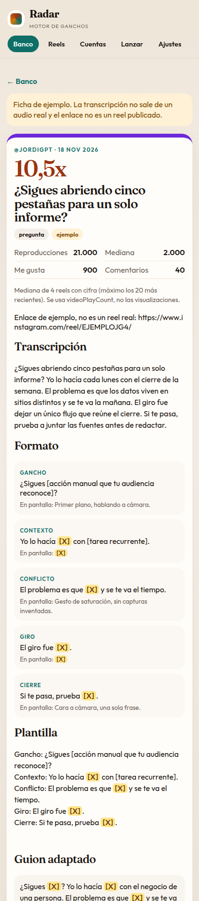

# Radar de ganchos

Motor para Antonio: mirar cuentas de Instagram, encontrar reels y carruseles que rinden muy por encima de lo normal, sacarles el formato y proponer un guion con huecos `[X]` donde haga falta una experiencia real.

La interfaz está en español. La biblioteca filtra por categoría, formato y texto. Cada ficha tiene gancho, receta, prompts, ajustes, ideas, monetización y adaptación al perfil. El flujo guiado va de la oferta al Markdown. El tablero kanban y el teleprompter no están: quedan para más adelante.

No inventa métricas. Si un dato no viene del navegador, de Apify, de Instaloader, de la transcripción, del OCR, del embed público de TikTok, de la pestaña Reels o de una fixture marcada como ejemplo, no aparece.

También vigila cuentas de TikTok que venden con slideshows ([Radar de cuentas TikTok](#radar-de-cuentas-tiktok)) y creadores de Instagram del nicho de IA ([Radar de creadores de Instagram](#radar-de-creadores-de-instagram)). De las piezas virales que no están fijadas saca una biblioteca de ganchos y formatos ([Ganchos y formatos](#ganchos-y-formatos)).

## Qué hace una tanda

1. Lee la watchlist (al empezar: `jordigpt`, `dani_llamazares`, `victorinpublic`, `crawlingmondays`, `gregisenberg`).
2. Muestra la estimación y no llama a nadie hasta que lo confirmas. La fuente por defecto es el navegador (0 USD). Apify e Instaloader se eligen con `--source`.
3. Pide como máximo 20 posts recientes por cuenta, con pausas al azar y un tope de perfiles. Solo cuentas públicas de la watchlist.
4. En un reel, la mediana es la de `videoPlayCount` de los últimos 20 con cifra. En un carrusel no hay reproducciones: la cifra es `me gusta + 4 × comentarios`, contra la mediana de los últimos carruseles de esa cuenta. Outlier si llega a **2× o más**. El 4 es una regla de esta app para que un comentario pese más; no es una métrica de Instagram. Si falta me gusta o comentarios, ese carrusel no entra en la mediana.
5. Transcribe en local solo los reels outlier (faster-whisper). En un carrusel junta el texto de las diapositivas y, si falta, pasa OCR. Las imágenes se borran al terminar salvo `--conservar-imagenes`.
6. Pide a un LLM el tipo de gancho, los bloques, una plantilla y un guion adaptado al perfil. El modelo tiene prohibido inventar cifras; si cuela alguna, la ficha lo avisa. La ficha arma además los siete bloques y el desglose con las marcas de tiempo que ya trae la transcripción.
7. Guarda todo en SQLite.

## Arranque en Windows

Hace falta Python 3.11 o superior y PowerShell. Desde la carpeta del proyecto:

```powershell
py -3.11 -m venv .venv
.\.venv\Scripts\Activate.ps1
python -m pip install -e ".[dev,browser,ocr]"
python -m playwright install chromium
copy .env.example .env
radar seed
radar login
radar serve
```

`radar login` abre Chromium. Entras tú, con la cuenta secundaria, en la ventana. Radar no pide la contraseña y no la guarda: solo queda el perfil del navegador en `data\ig-browser`. Cuando veas el inicio de Instagram, vuelve a la terminal y pulsa Enter.

El scraping con sesión va contra las condiciones de Instagram y puede llevar al bloqueo de la cuenta secundaria.

Abre http://127.0.0.1:8000 . La primera vez, si la base está vacía, carga sola la watchlist y los reels de ejemplo. Esas cifras no son reales: la interfaz lo dice en un aviso amarillo.

El OCR es `rapidocr-onnxruntime` (el extra `ocr`). No hace falta instalar Tesseract. Si no lo instalas, los carruseles que ya traen texto se leen igual; los que solo tienen imagen quedan con un aviso y sin gancho inventado.

Codex en este sistema: `npm install -g @openai/codex` deja `codex.cmd`, no un `.exe`. Radar lo busca en el PATH (o en `RADAR_CODEX_BIN`, si lo cambias) y le manda el prompt en UTF-8. No hace falta definir `PYTHONUTF8`.

Whisper va aparte, porque el modelo pesa:

```powershell
python -m pip install -r requirements-whisper.txt
```

En bash el equivalente del entorno es `python3 -m venv .venv` y `source .venv/bin/activate`. El resto de los comandos es el mismo. La imagen Docker no trae Chromium: el navegador está pensado para el ordenador de Antonio, no para el VPS.

## Capturas

Así se ve con los datos de ejemplo. Las cifras son ficticias.





Los tests:

```bash
pytest
```

No hace falta token. Los tests no llaman a Apify.

## Variables de entorno

| Variable | Para qué |
| --- | --- |
| `APIFY_TOKEN` | Token de Apify. Sin él la app arranca, pero no hace ninguna petición. |
| `APIFY_USD_PER_1000` | Tarifa de referencia. Por defecto `2.60` (plan Free del actor). |
| `APIFY_MONTHLY_CREDIT_USD` | Crédito de referencia. Por defecto `5`. |
| `RADAR_REELS_PER_ACCOUNT` | Reels pedidos por cuenta. Por defecto `20`. |
| `RADAR_OUTLIER_MULTIPLE` | Umbral. Por defecto `2`. |
| `RADAR_DB` | Ruta del SQLite. Por defecto `data/radar.sqlite`. |
| `WHISPER_MODEL` | Por defecto `small`. |
| `WHISPER_DEVICE` | Por defecto `cpu`. |
| `WHISPER_COMPUTE_TYPE` | Por defecto `int8`, para un VPS de unos 2 GB. |
| `WHISPER_LANGUAGE` | Por defecto `es`. |
| `RADAR_LLM` | `codex` (por defecto si no hay clave), `openai`, `anthropic` o `none`. `LLM_PROVIDER` sigue valiendo como alias. |
| `RADAR_CODEX_MODEL` | Modelo opcional de Codex. Si falta, usa el de la sesión. |
| `RADAR_LLM_DELAY_SECONDS` | Pausa entre reels con Codex. Por defecto 2. |
| `LLM_MODEL` | Obligatorio solo con `openai` o `anthropic`. |
| `OPENAI_API_KEY` | Clave de API, solo si no quieres la suscripción de ChatGPT. |
| `OPENAI_BASE_URL` | Por defecto `https://api.openai.com/v1`. |
| `ANTHROPIC_API_KEY` | Solo si `RADAR_LLM=anthropic`. |
| `TUBEALFRED_API_KEY` | Reservada. No activa nada. Ver más abajo. |
| `RADAR_SOURCE` | `playwright` (por defecto), `apify`, `instaloader` o `auto`. |
| `IG_USERNAME` | Cuenta secundaria para Instaloader. No es la cuenta que miras. |
| `IG_SESSION_FILE` | Fichero de sesión. Por defecto `data/ig.session`. No es la contraseña. |
| `RADAR_IG_MAX_ACCOUNTS` | Máximo de cuentas por tanda con Instaloader. Por defecto 10. |
| `IG_BROWSER_PROFILE` | Carpeta de la sesión de Chromium. Por defecto `data/ig-browser`. |
| `RADAR_BROWSER_MAX_ACCOUNTS` | Máximo de perfiles por tanda con el navegador. Por defecto 5. |
| `RADAR_BROWSER_MAX_POSTS` | Máximo de posts por perfil. Por defecto 20. |
| `RADAR_BROWSER_PAUSE_ACCOUNT` | Pausa al azar entre perfiles, `mínimo-máximo` en segundos. Por defecto `25-70`. |
| `RADAR_BROWSER_PAUSE_POST` | Pausa al azar entre páginas del mismo perfil. Por defecto `3-8`. |
| `RADAR_COMMENT_WEIGHT` | Cuántos me gusta vale un comentario en un carrusel. Por defecto `4`. |
| `RADAR_HOST` / `RADAR_PORT` | Por defecto `127.0.0.1:8000`. |
| `RADAR_TT_PAUSE` | Pausa al azar entre lecturas de TikTok, `mínimo-máximo` en segundos. Por defecto `2-6`. |
| `RADAR_TT_MAX` | Cuentas de TikTok que se leen enteras en una pasada. Por defecto `12`. El resto se queda en cola. |
| `RADAR_TT_MAX_PAGINAS` | Páginas de descubrimiento por pasada (embed de tag, búsquedas y listas). Por defecto `12`. |
| `RADAR_TT_VISTAS_MIN` | Vistas mínimas de una pieza viral, además del 2×. Por defecto `50000`. |
| `RADAR_TT_APIFY_ACTOR` | Actor opcional. Sin esto, o sin `--apify`, no se llama a Apify. |
| `RADAR_IG_CREADORES_PAUSE` | Pausa al azar entre perfiles de Instagram, `mínimo-máximo` en segundos. Por defecto `25-50`. |
| `RADAR_IG_CREADORES_MAX` | Perfiles de Instagram por pasada. Por defecto `30`. |
| `RADAR_IG_CREADORES_MAX_PAGINAS` | Páginas de hashtag o listas por pasada. Por defecto `2`. |
| `RADAR_IG_CREADORES_VISTAS_MIN` | Reproducciones mínimas de un reel viral, además del 2×. Por defecto `50000`. |
| `RADAR_IG_CREADORES_REELS` | Reels recientes no fijados que entran en la mediana. Por defecto `20`. |
| `RADAR_IG_CREADORES_APIFY_ACTOR` | Actor opcional. Sin esto, o sin `--apify`, no se llama a Apify. |

Copia `.env.example`. Los secretos no se guardan en la base y la pantalla de Ajustes solo dice si están definidos.

Sin `OPENAI_API_KEY` ni `ANTHROPIC_API_KEY`, el análisis usa Codex y la suscripción de ChatGPT. Para volver a una API de pago, mira la sección siguiente.

## Coste estimado

Fuente: ficha pública de [apify/instagram-reel-scraper](https://apify.com/apify/instagram-reel-scraper), consultada el 23 de noviembre de 2026. El actor cobra por resultado. En el plan Free son **2,60 USD por cada 1.000 reels**. El crédito mensual del plan Free es **5 USD**. Apify puede cambiar la tarifa: si cambia, pon el precio nuevo en `APIFY_USD_PER_1000` y el crédito en `APIFY_MONTHLY_CREDIT_USD`. La app no consulta tu saldo.

Con la watchlist de 5 cuentas y 20 reels por cuenta:

| Concepto | Cifra |
| --- | --- |
| Resultados de una tanda | 100 |
| Coste estimado de esa tanda | 0,26 USD |
| Crédito mensual de referencia | 5,00 USD |
| Tandas como esta que caben | 19 |
| Reels que caben en esos 5 USD | 1.923 |
| Proyección de 4 tandas al mes | 1,04 USD |

La proyección no es un cargo. Es 4 veces la estimación, para ver una cadencia semanal.

Estos add-ons van apagados a propósito, porque se cobran aparte:

- `includeTranscript` (por minuto de audio; transcribimos en local)
- `includeDownloadedVideo` (por MB)
- `includeSharesCount`

`radar run` imprime la estimación antes de lanzar. Sin `--yes` y sin una terminal interactiva no llama a nadie. En la web, el botón exige marcar que has visto la estimación. Si eliges Apify y la cifra pasa del crédito, la tanda no sale salvo que pidas `--allow-over-budget`. En `auto`, si no hay sesión de navegador y la estimación de Apify no cabe, se cambia a Instaloader y el coste que se imprime es **0,00 USD**.

## Navegador, la fuente por defecto

Hace falta una **cuenta secundaria**. `radar login` abre Chromium una vez. La contraseña no entra en el código, ni en la base, ni en los logs: la escribes en la ventana del navegador. El perfil queda en `IG_BROWSER_PROFILE`.

La tanda va despacio a propósito: entre 25 y 70 segundos al azar entre perfiles, y entre 3 y 8 entre la página de reels y la de posts. Como máximo entran 5 perfiles y 20 posts por perfil. Si Instagram responde 401, 429, checkpoint o challenge, la tanda se para, se guardan los posts ya leídos y no se reintenta.

Solo se abren los perfiles de la watchlist. Una cuenta privada se omite. No se leen mensajes, seguidores ni cuentas que no estés vigilando.

El scraping con sesión va contra las condiciones de Instagram y puede llevar al bloqueo de la cuenta secundaria.

```powershell
radar login
radar run --dry-run
radar run --yes
radar run --source apify --yes
radar run --source instaloader --yes
```

## Instaloader, el respaldo

Instaloader es la alternativa gratuita si no quieres el navegador. No gasta el crédito de 5 USD.

`RADAR_SOURCE=auto` usa el navegador si ya hay sesión. Si no la hay, usa Apify cuando hay `APIFY_TOKEN` y la estimación cabe. Cae a Instaloader si no hay token, si el coste no cabe, si pasas `--source instaloader`, o si Apify responde 402 / sin crédito / sin cuota. Ese fallo de Apify no se reintenta. El valor por defecto de `RADAR_SOURCE` es `playwright`, no `auto`.

Hace falta una **cuenta secundaria** de Instagram, no la cuenta desde la que publicas:

```bash
# en .env: IG_USERNAME=la_cuenta_secundaria
radar ig-login
```

`radar ig-login` llama al login interactivo de Instaloader. La contraseña la pide la librería en la terminal (no se ve al escribir) y **no se guarda** en la base, en los logs de esta app ni en `.env`. Solo se guarda el fichero de sesión (`IG_SESSION_FILE`, por defecto `data/ig.session`, permisos `600`).

La tanda va despacio a propósito: entre 20 y 60 segundos al azar entre cuentas, y una pausa corta entre reels. Como máximo entran 10 cuentas por tanda (las primeras en orden alfabético; el resto se deja para la siguiente). Si Instagram responde 401, 429, checkpoint o pide login, la tanda se para y no se reintenta. Los reels ya leídos se guardan.

**Riesgo.** Esta vía puede limitar o pedir checkpoint a la cuenta que inicia sesión. Usa una cuenta secundaria, de poco valor. Instaloader entra con la IP de la máquina que lanza el comando: si Instagram bloquea el VPS, no insistas desde ahí; lanza `radar run --source instaloader` desde una IP residencial. No subas el ritmo ni bajes las pausas.

Si Instaloader no trae `video_play_count` y sí trae vistas, esas vistas se guardan como reproducciones. Si no, la mediana saldría vacía. El detector sigue usando solo ese campo, igual que con Apify.

La salida normal del actor ya trae `audioUrl` y `videoUrl`. Esas URLs caducan: la transcripción tiene que ir justo después de la ingesta, en la misma tanda.

## Outliers

Por cada cuenta se toman como máximo los **20 reels más recientes que tienen reproducciones** (`videoPlayCount` en el modelo interno). La mediana es la de ese grupo (si hay un número par, la media de los dos centrales). Un reel es outlier si su cifra es **mayor o igual que 2 veces** la mediana. El campo `videoViewCount` no entra en la mediana; Instaloader solo copia las vistas a las reproducciones cuando no hay play count.

Con un solo reel, la mediana es él mismo: sale 1× y no es outlier. Hace falta el grupo para tener con qué comparar.

## Transcripción

Solo outliers, uno detrás de otro. Se prefiere `audioUrl` y, si no viene, `videoUrl`. faster-whisper con el modelo `small`, CPU e `int8`. Hace falta `ffmpeg` en el sistema.

El gancho guardado es la primera frase. Si el primer segmento se alarga más de unos 3 segundos, se queda el texto de esa apertura.

El paquete no se instala con el resto: pesa y el modelo se baja en el primer uso (varios cientos de MB, en `/data/huggingface` dentro de Docker).

```bash
pip install -r requirements-whisper.txt
```

Si no está instalado, la ingesta de metadatos se guarda igual y la ficha explica que falta Whisper.

En un VPS de unos 2 GB no lances el modelo dentro del mismo proceso que atiende la web. Usa un contenedor aparte para el cron (más abajo).

## LLM con la suscripción de ChatGPT

El prompt obliga a no inventar cifras, porcentajes, dinero, fechas ni resultados, y a escribir `[X]` donde Antonio tenga que poner algo suyo. Después, el código compara los números del guion y de la plantilla con la transcripción y el pie. Si aparece una cifra que no estaba, la ficha muestra un aviso. No se borra sola: la tienes que revisar.

Por defecto el backend es **Codex CLI** (`@openai/codex`). El uso cuenta contra el plan ChatGPT Plus o Pro, no contra una clave de API. Las llamadas van de una en una, con una pausa (`RADAR_LLM_DELAY_SECONDS`, 2 segundos). Si Codex responde límite de uso, la tanda se para: lo ya analizado se queda guardado y el resto sigue pendiente para la próxima ejecución. No se reintenta ese reel en la misma tanda. Si el JSON no vale, se pide una sola vez más.

Instalación en el ordenador:

```bash
npm install -g @openai/codex
codex login
radar llm-check
```

En un VPS, el contenedor ya trae Node y Codex. La sesión vive en el volumen `codex-auth` (`/root/.codex`):

```bash
docker compose run --rm -it radar codex login --device-auth
docker compose run --rm radar radar llm-check
```

`codex login` abre el navegador. `--device-auth` muestra un código para entrar desde otro dispositivo. `radar llm-check` manda un prompt mínimo y comprueba que la respuesta es el JSON del análisis.

El comando que se lanza es `codex exec`, con `--skip-git-repo-check`, `--sandbox read-only`, `--json` y `--output-last-message`. El prompt entra por stdin (`-`). `RADAR_CODEX_MODEL` añade `--model` si quieres fijar uno; si no, vale el de la sesión.

Para volver a una clave de API:

```bash
# .env
RADAR_LLM=openai
OPENAI_API_KEY=sk-...
LLM_MODEL=el-modelo-vigente
```

`RADAR_LLM=anthropic` usa `ANTHROPIC_API_KEY`. `RADAR_LLM=none` no analiza. `LLM_PROVIDER` sigue funcionando como alias de `RADAR_LLM`.

## Banco, Markdown y JSON

El banco lista los outliers y se filtra por cuenta, tipo de gancho, múltiplo mínimo y fecha. Cada ficha enlaza el reel (en los ejemplos el enlace es ficticio), la transcripción, la plantilla y el guion.

`banco-ganchos.md` de la entrega anterior no estaba en este repositorio. El Markdown que exporta la app es el formato de este banco. Cada entrada lleva un título con el múltiplo en coma decimal, el creador y la fecha:

```markdown
## 10,5x · @jordigpt · 2026-11-18
```

Debajo van creador, URL, reproducciones, mediana, me gusta, comentarios, tipo de gancho y si es un ejemplo. Luego las secciones Gancho, Transcripción, Formato, Plantilla y Guion adaptado.

Desde la interfaz: Markdown, JSON del filtro y, en Ajustes, una copia JSON de todo. Por terminal:

```bash
radar export md --out banco-ganchos.md
radar export json --out copia.json
radar import json copia.json
```

La copia JSON es el puente para mover los datos entre el móvil y el ordenador. La base es un solo SQLite y todo pasa por `radar/db.py`, para poder cambiarla más adelante por un almacén remoto sin rehacer la interfaz.

## Perfil, biblioteca y flujo

El perfil guarda marca, oferta, audiencia, problema, tono, idioma, pruebas, restricciones, CTA y nicho. Lo que dejes vacío se ve como `[X]`.

```powershell
radar perfil ver
radar perfil guardar --oferta "Acompañamiento para montar el flujo" --cta "Escríbeme" --nicho "IA, negocio de una persona, Grok Bot"
radar banco
radar banco --categoria "pregunta de apertura" --q pestanas
radar banco --formato carrusel --ocultar-ejemplos
```

La categoría sale del tipo de gancho (pregunta de apertura, choque de expectativa, lista o pasos, relato en primera persona, muestra de herramienta, error y corrección, contraste, novedad, lectura por diapositivas, sin clasificar). El formato es reel o carrusel. La búsqueda ignora los acentos.

El flujo no acepta un ejemplo: solo un outlier con métricas guardadas. Las variantes cambian el cierre de esa plantilla; no inventan otro formato.

```powershell
radar flujo nuevo "Cierre de la semana"
radar flujo list
radar flujo oferta 1 --oferta "Acompañamiento para montar el flujo" --cta "Escríbeme"
radar flujo referencias 1 --reel 12
radar flujo hook 1 --reel 12
radar flujo guion 1
radar flujo variantes 1
radar flujo revision 1 --notas "Sin cifras nuevas" --aprobar
radar flujo exportar 1 --out pieza.md
radar flujo ver 1
```

En la web son `/perfil` y `/flujo`. La biblioteca sigue en `/banco`.

## Carruseles

Un carrusel se guarda con el texto de cada diapositiva. Si una diapositiva no trae texto y sí una imagen de Instagram, el OCR local la lee y el fichero se borra. `--conservar-imagenes` deja la copia en `data/slides`. No se descargan imágenes de otros hosts.

El gancho es la primera diapositiva. La plantilla tiene un `[X]` por diapositiva, con el papel de cada una (gancho, desarrollo, cierre). Hace falta más de un carrusel con me gusta y comentarios en la cuenta: con uno solo el múltiplo es 1× y no entra en el banco.

## CLI

```powershell
radar accounts list
radar accounts add jordigpt
radar accounts remove jordigpt
radar login
radar ig-login
radar perfil ver
radar perfil guardar --cta "Escríbeme"
radar banco --q pestanas
radar flujo list
radar llm-check
radar run --dry-run
radar run --yes
radar run --source playwright --yes
radar run --source instaloader --yes
radar run --source apify --yes
radar run --conservar-imagenes --yes
radar serve
radar cuentas descubrir
radar cuentas descubrir --yes
radar cuentas actualizar --yes
radar cuentas exportar --out cuentas-tiktok.csv
radar cuentas programar
radar creadores descubrir
radar creadores descubrir --yes
radar creadores ciclo --yes
radar creadores exportar --out cuentas-instagram.csv
radar creadores programar
radar ganchos extraer --fuente todas --max 8
radar ganchos extraer --fuente tiktok --yes
radar ganchos analizar --yes
radar ganchos exportar --out data/ganchos
radar ganchos programar
```

`radar run --yes` es el comando del cron de la watchlist. El de TikTok y el de creadores de Instagram, cada mañana en Windows, están en las secciones siguientes.

## Radar de cuentas TikTok

Busca cuentas que venden algo (sobre todo apps, también tiendas y productos) con slideshows, se queda con las que tienen viralidad real y las acumula por handle. La pestaña está en `radar serve`, ruta `/tiktok`.

Una pieza cuenta como viral si **no está fijada**, sus vistas son **al menos el doble de la mediana** y **al menos 50.000**. La mediana es la de las últimas publicaciones que devuelve `https://www.tiktok.com/embed/@usuario` (unas 10), sin las fijadas. Si el embed trae `isPinned`, `is_top` o la insignia de fijada, manda esa marca. Si no trae ninguna, las que van delante y son más viejas que el bloque reciente (de más nuevo a más viejo) se tratan como fijadas. Sin fechas, las que sobran por encima de 10 se tratan como fijadas. Una fijada no entra en la mediana, no cuenta como viral y no puede ser la mejor pieza. Un múltiplo de miles sale de haber metido en la mediana una fijada de millones de vistas: con las fechas del id, esa pieza queda fuera. La cuenta pasa si además vende algo que se ve en la bio, el enlace o los pies, y al menos la mitad de la muestra es slideshow (portada `photomode`).

Las cifras salen de esa lectura. Si TikTok no devuelve seguidores o vistas, el campo se queda vacío: no se pone un cero ni se redondea un «1,2M» a mano. La columna `fuente` dice de dónde salió y qué día se leyó.

La primera vez, la base carga sola el corte de 129 cuentas (`radar/fixtures/cuentas-tiktok.csv`). También vale `radar cuentas importar ruta.csv`. Un handle repetido se actualiza y **conserva `fecha_detectada`**.

```powershell
radar cuentas descubrir
radar cuentas descubrir --yes
radar cuentas actualizar --yes
radar cuentas ciclo --yes
radar cuentas exportar --out cuentas-tiktok.csv
radar cuentas listar --nicho "Belleza"
radar cuentas semilla "#studyapp"
radar cuentas programar
```

Sin `--yes` no hay ninguna petición: solo enseña el plan. `descubrir` encola handles nuevos. `actualizar` vuelve a leer las que ya califican, las más antiguas primero, y no borra las que no toca. `ciclo` hace las dos; si TikTok bloquea a mitad, para y no sigue con la actualización.

De dónde salen las cuentas, sin login y sin API de pago:

- El embed público del tag, `tiktok.com/embed/tag/nombre`. La página `/tag/` a secas no trae autores. El embed sí: el campo `authorUniqueId`. El tag sale del nombre de la app y de las palabras del nicho de las cuentas que ya califican (EasyStars, astrología, …), más las semillas que añadas tú. Un hashtag suelto del pie, si no es eso, no se guarda ni se abre.
- Búsquedas `site:tiktok.com/photo "nombre de la app"` en Bing (RSS) y en el HTML de DuckDuckGo. Si el buscador no devuelve enlaces, no se inventa ninguno.
- Listas públicas (por defecto gr0w, Reelsfarm y similares) y los enlaces de categorías de esa misma web.
- Menciones `@cuenta` en bios y pies ya leídos.
- Apify solo si pasas `--apify` y hay `APIFY_TOKEN` y `RADAR_TT_APIFY_ACTOR`. Si falta cualquiera, no se llama. Del actor solo se guardan handles; las vistas se leen después en el embed.

Entre lecturas hay una pausa al azar (`RADAR_TT_PAUSE`, por defecto 2–6 segundos). `RADAR_TT_MAX` (12) es cuántas cuentas se leen enteras; las demás se quedan en cola para la siguiente pasada. `RADAR_TT_MAX_PAGINAS` (12) es cuántas páginas de descubrimiento se abren. `RADAR_TT_VISTAS_MIN` (50000) es el suelo de vistas, además del doble de la mediana. Un 403 para la pasada a la primera. Un 429 espera entre 60 y 120 segundos y reintenta esa petición una vez; si vuelve a responder 429, para. El status 10221 de una cuenta (privada o embed no disponible) se anota en esa cuenta y no para el resto. Lo ya guardado se queda.

El nicho, el subnicho y el «qué vende» los propone el mismo LLM que el resto de la app (`codex exec` por defecto). Si no responde, se usa una heurística y la ficha queda como «REVISAR». Una clasificación «revisada a mano» no se pisa al actualizar.

En Windows, cada día a las 07:00:

```powershell
radar cuentas programar --hora 07:00
radar cuentas programar --hora 07:00 --instalar
```

Eso escribe `data\radar-cuentas-tiktok.ps1` (entra en la carpeta del proyecto y lanza `radar cuentas ciclo --yes`) e imprime el `schtasks` correspondiente. `--instalar` registra la tarea solo en Windows.

## Radar de creadores de Instagram

Busca creadores del nicho de inteligencia artificial y de negocios montados con IA (herramientas, automatización, agencia, productividad, programación o vibe coding, noticias, solopreneurs) que tengan al menos un reel viral, y los acumula por usuario. La pestaña está en `radar serve`, ruta `/instagram`. Español e inglés salen primero.

Un reel cuenta como viral si **no está fijado**, sus reproducciones son **al menos el doble de la mediana** y **al menos 50.000**. La mediana es la de hasta 20 reels recientes **no fijados** que traen cifra. La marca sale de `pinned`, `timeline_pinned_user_ids`, `clips_tab_pinned_user_ids`, `pinned_for_users` o la insignia de fijado. Un fijado no entra en la mediana, no cuenta como viral y no puede ser la mejor pieza. Los carruseles no entran. La cuenta pasa si, además, la bio y los pies son de ese nicho.

Las cifras salen de la pestaña Reels, leída con la misma sesión de Chromium que el motor (`radar login`, carpeta `IG_BROWSER_PROFILE`). Si Instagram no devuelve seguidores o reproducciones, el campo se queda vacío: no se pone un cero ni se interpreta un «1,2M». La columna `fuente` dice de dónde salió y qué día se leyó.

La primera vez, la base carga sola el corte de 34 creadores (`radar/fixtures/cuentas-instagram.csv`). También vale `radar creadores importar ruta.csv`. Un usuario repetido se actualiza y **conserva `fecha_detectada`**. Una clasificación «revisada a mano» no se pisa al actualizar.

```powershell
radar creadores descubrir
radar creadores descubrir --yes
radar creadores actualizar --yes
radar creadores ciclo --yes
radar creadores exportar --out cuentas-instagram.csv
radar creadores listar --subnicho "Herramientas IA" --idioma es
radar creadores semilla "#herramientasia"
radar creadores programar
```

Sin `--yes` no se abre Instagram: solo enseña el plan. `descubrir` encola usuarios nuevos. `actualizar` vuelve a leer los que ya califican, los de lectura más antigua primero, y no borra las métricas si esa ficha no responde. `ciclo` hace las dos; si Instagram bloquea a mitad, para y no sigue con la actualización.

De dónde salen los usuarios, sin API de pago:

- Semillas que puedes cambiar: palabras, `#hashtags`, `@cuentas` y URLs de listas públicas.
- Menciones `@cuenta` en bios y pies ya leídos, más colaboradores y cuentas etiquetadas en los reels.
- Cuentas sugeridas, solo si vienen en la misma ficha. No se abre una página extra para buscarlas.
- Apify solo si pasas `--apify` y hay `APIFY_TOKEN` y `RADAR_IG_CREADORES_APIFY_ACTOR`. Si falta cualquiera, no se llama. Del actor solo se guardan usuarios; las reproducciones se leen después en Reels.

Entre perfiles hay una pausa al azar (`RADAR_IG_CREADORES_PAUSE`, 25–50 segundos). Cada pasada tiene un tope (`RADAR_IG_CREADORES_MAX`, 30 perfiles, y `RADAR_IG_CREADORES_MAX_PAGINAS`, 2 páginas). Un 401, un 403 de la página, un 429, un checkpoint, un challenge o un muro de login paran toda la pasada. Lo ya guardado se queda. La cuenta es la tuya: no subas el tope ni bajes la pausa si no hace falta.

El subnicho y el idioma los propone el mismo LLM que el resto de la app (`codex exec` por defecto). Si no responde, se usa una heurística y la ficha queda como «REVISAR». Si el texto no es de IA, la cuenta se descarta aunque el reel sea viral.

En Windows, cada día a las 07:30, un rato después de la tarea de TikTok:

```powershell
radar creadores programar --hora 07:30
radar creadores programar --hora 07:30 --instalar
```

Eso escribe `data\radar-creadores-instagram.ps1` (entra en la carpeta del proyecto y lanza `radar creadores ciclo --yes`) e imprime el `schtasks` correspondiente. `--instalar` registra la tarea solo en Windows. Hace falta haber hecho `radar login` en esa misma máquina: la tarea reutiliza el perfil del navegador.

`radar run --yes` es el comando del cron de la watchlist de ganchos. Imprime la fuente y la estimación, y luego lanza. Con el navegador o con Instaloader el coste impreso es 0,00 USD. `--skip-transcribe` y `--skip-llm` saltan esos pasos. `--source` vale `playwright`, `apify`, `instaloader` o `auto`.

El corte ya importado puede seguir listando una fijada como mejor pieza, con la marca `| fijado`. La biblioteca de ganchos no la lee. La ficha la enseña aparte, bajo «no cuentan». La próxima `radar cuentas actualizar` o `radar creadores actualizar` vuelve a calcular la mediana y las virales sin esas piezas.

## Ganchos y formatos

De las cuentas que califican saca el gancho y el formato de cada pieza viral **no fijada**, y los deja en una biblioteca que se puede filtrar. La pestaña está en `radar serve`, ruta `/ganchos`. El ranking de formatos está en `/ganchos/formatos`.

El orden de lectura es el múltiplo guardado (de mayor a menor) y, si empatan, las vistas. `--max` corta esa cola. Sin `--max`, TikTok se queda en `RADAR_TT_MAX` (12) e Instagram en `RADAR_IG_CREADORES_MAX` (30). Una fijada se anota en la base con `fijada = 1` y estado `omitida`: no se descarga, no se transcribe y no se analiza. Un vídeo de TikTok (la línea trae `| vídeo`) tampoco entra: aquí solo slideshows.

```powershell
radar ganchos extraer --fuente todas
radar ganchos extraer --fuente tiktok --max 8 --yes
radar ganchos extraer --fuente instagram --yes
radar ganchos analizar
radar ganchos analizar --yes
radar ganchos ciclo --yes
radar ganchos exportar --out data/ganchos
radar ganchos programar --hora 09:00
```

Sin `--yes`, `extraer` y `analizar` solo enseñan el plan. No hay peticiones ni llamadas al modelo.

**TikTok.** Para cada slideshow viral pide primero `https://m.tiktok.com/v/ID.html` (ahí viene `imagePost.images`), luego la página, el embed y el oEmbed. Si ninguna trae imágenes y Playwright está instalado, abre la página pública una vez. No hay login. Entre lecturas usa `RADAR_TT_PAUSE` (2–6 segundos). Un 403 para la pasada. Un 429 espera y reintenta esa petición una vez; si se repite, para. De cada imagen (solo CDN de TikTok) pasa OCR y guarda el número de diapositivas, el texto de cada una, el pie, la diapositiva en la que aparece el producto y el CTA si el texto lo dice. Si no hay diapositivas o el OCR no lee nada, la pieza queda en error, con una línea en el resumen, y la siguiente pasada la vuelve a intentar. No se inventa el gancho. `--reintentar` vuelve a leer también las que ya tenían texto.

**Instagram.** Reutiliza la sesión de `radar login` y las mismas pausas del radar de creadores (`RADAR_IG_CREADORES_PAUSE`, 25–50 segundos). Abre el reel, guarda el pie, transcribe el audio con faster-whisper y lee el texto en pantalla (el que trae la ficha o, si no, el OCR de la portada de Instagram). Un 401, un 403, un 429, un checkpoint o un challenge paran la pasada. Si al abrir el reel la ficha dice que está fijado, se marca y no se analiza.

**Análisis.** Lo hace el mismo Codex de la suscripción de ChatGPT (`codex exec`), una pieza cada vez, con la pausa `RADAR_LLM_DELAY_SECONDS`. De cada pieza pide el gancho (primera diapositiva, o lo dicho en los primeros segundos más el texto en pantalla), el tipo, el formato (lista, antes y después, historia en primera persona, cosas que me hubiera gustado saber, mito y verdad, tutorial, comparación…), cómo entra el producto, el ángulo, por qué encaja con el material y una plantilla con `[X]`. La adaptación al perfil de `radar perfil` se guarda como **sugerencia**: no es una métrica. Si el modelo mete una cifra que no estaba en la pieza, la ficha lo avisa.

Lo ya analizado se salta. Una pieza cuyo JSON no valió sigue pendiente y entra en la siguiente pasada. Si Codex responde límite de uso, la tanda para y la próxima ejecución sigue por las que faltan. El tope `--max` cuenta solo piezas que aún no se han leído, así que cada pasada avanza por la cola. El ranking agrupa por nicho y subnicho: cuántas piezas y la mediana de su múltiplo guardado. Cada fila enlaza la URL de la pieza. No se calcula un múltiplo nuevo.

`exportar --out` escribe Markdown y CSV. Si `--out` es una carpeta, crea `ganchos.md` y `ganchos.csv`. Si es un `.md` o un `.csv`, escribe los dos al lado.

En Windows, después de las otras dos tareas:

```powershell
radar ganchos programar --hora 09:00
radar ganchos programar --hora 09:00 --instalar
```

Eso escribe `data\radar-ganchos.ps1` (`radar ganchos ciclo --yes`) e imprime el `schtasks`. `--instalar` registra la tarea solo en Windows. Conviene lanzarla cuando TikTok e Instagram ya han terminado, para que la cola tenga piezas nuevas.

## Docker y cron

```bash
cp .env.example .env
# rellena APIFY_TOKEN cuando lo tengas
docker compose up -d --build
```

La web queda en el puerto 8000. Sin token de Apify arranca igual y enseña los ejemplos. La sesión de ChatGPT de Codex queda en el volumen `codex-auth`; el login está en la sección del LLM.

Para transcribir en el VPS, construye la imagen con Whisper:

```bash
docker compose build --build-arg INSTALL_WHISPER=1
docker compose up -d
```

Cron semanal, en un contenedor que termina al acabar (no dentro del proceso de la web):

```cron
0 8 * * 1 cd /opt/radar && docker compose run --rm radar radar run --yes >> /var/log/radar.log 2>&1
```

No lances esa tanda a la vez que otra: comparten el mismo SQLite.

La interfaz no tiene login. No la publiques a internet sin un proxy con contraseña. El contenedor es un servicio de una sola persona.

## TubeAlfred

YouTube queda fuera. `TUBEALFRED_API_KEY` solo se lee para decir, en Ajustes, si está definida. `radar/tubealfred.py` documenta cómo activarlo más adelante: hace falta la documentación real de la API, no mezclar su mediana con la de Instagram, y exigir un flag explícito además de la clave. Hoy `enabled` es siempre falso y `fetch_recent` lanza un error.

## Datos de ejemplo

`radar/fixtures/apify_items.example.json` imita la forma del actor (`videoPlayCount`, `likesCount`, `commentsCount`, `timestamp`, `caption`, `url`, `videoUrl`, `audioUrl`) con cifras redondas y el aviso `[EJEMPLO]`. No son métricas de esas cuentas. Los guiones de ejemplo también son textos escritos para la demo, no transcripciones suyas.

Sirven para que el banco no esté vacío y para los tests de outliers, del parser y del Markdown.

## Más adelante

Tablero por estados y modo teleprompter. Favoritos, edición semanal y YouTube siguen fuera. El detalle está en `docs/PLAN-MEJORAS.md`.
