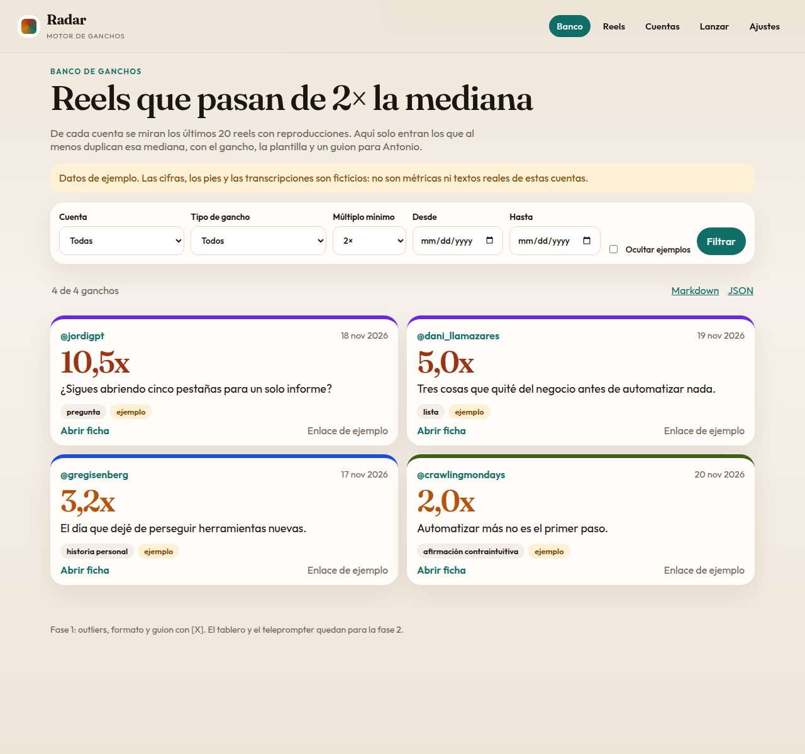
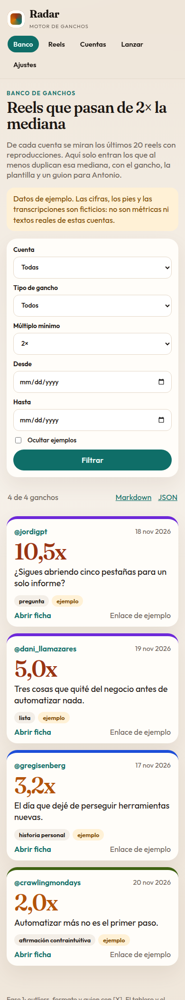
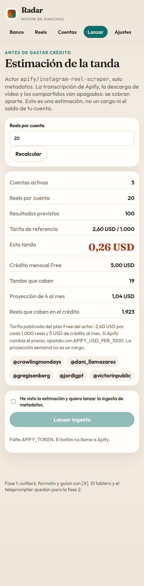
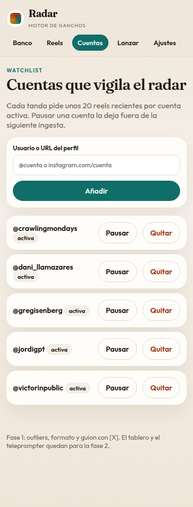

# Radar de ganchos

Motor para Antonio: mirar cuentas de Instagram, encontrar reels que rinden muy por encima de lo normal, sacarles el formato y proponer un guion con huecos `[X]` donde haga falta una experiencia real.

La interfaz está en español y está pensada para el móvil. El tablero kanban y el teleprompter no están en esta versión: quedan para la fase 2. Aquí hay una lista simple de reels y el banco de outliers.

No inventa métricas. Si un dato no viene de Apify, de la transcripción o de una fixture marcada como ejemplo, no aparece.

## Qué hace una tanda

1. Lee la watchlist (al empezar: `jordigpt`, `dani_llamazares`, `victorinpublic`, `crawlingmondays`, `gregisenberg`).
2. Muestra el coste estimado y no llama a Apify hasta que lo confirmas.
3. Pide unos 20 reels recientes por cuenta al actor `apify/instagram-reel-scraper`, solo metadatos.
4. Calcula la mediana de `videoPlayCount` de esos reels y marca outlier si el reel llega a **2× o más**.
5. Transcribe en local solo los outliers (faster-whisper, modelo pequeño, CPU).
6. Pide a un LLM el tipo de gancho, los bloques (gancho, contexto, conflicto, giro, cierre), una plantilla y un guion adaptado. El modelo tiene prohibido inventar cifras; si cuela alguna, la ficha lo avisa.
7. Guarda todo en SQLite.

## Arranque en local

Hace falta Python 3.11 o superior.

```bash
python3 -m venv .venv
source .venv/bin/activate
pip install -e ".[dev]"
cp .env.example .env
radar seed
radar serve
```

Abre http://127.0.0.1:8000 . La primera vez, si la base está vacía, carga sola la watchlist y los reels de ejemplo. Esas cifras no son reales: la interfaz lo dice en un aviso amarillo.

## Capturas

Así se ve con los datos de ejemplo. Las cifras son ficticias.










Los tests:

```bash
pytest
```

No hace falta token. Los tests no llaman a Apify.

## Variables de entorno

| Variable | Para qué |
| --- | --- |
| `APIFY_TOKEN` | Token de Apify. Sin él la app arranca, pero no hace ninguna petición. |
| `APIFY_USD_PER_1000` | Tarifa de referencia. Por defecto `2.60` (plan Free del actor). |
| `APIFY_MONTHLY_CREDIT_USD` | Crédito de referencia. Por defecto `5`. |
| `RADAR_REELS_PER_ACCOUNT` | Reels pedidos por cuenta. Por defecto `20`. |
| `RADAR_OUTLIER_MULTIPLE` | Umbral. Por defecto `2`. |
| `RADAR_DB` | Ruta del SQLite. Por defecto `data/radar.sqlite`. |
| `WHISPER_MODEL` | Por defecto `small`. |
| `WHISPER_DEVICE` | Por defecto `cpu`. |
| `WHISPER_COMPUTE_TYPE` | Por defecto `int8`, para un VPS de unos 2 GB. |
| `WHISPER_LANGUAGE` | Por defecto `es`. |
| `LLM_PROVIDER` | `openai`, `anthropic` o `none`. |
| `LLM_MODEL` | Nombre del modelo. Sin esto no hay análisis. |
| `OPENAI_API_KEY` | Clave para una API compatible con OpenAI (también xAI u OpenRouter, cambiando la base). |
| `OPENAI_BASE_URL` | Por defecto `https://api.openai.com/v1`. |
| `ANTHROPIC_API_KEY` | Solo si `LLM_PROVIDER=anthropic`. |
| `TUBEALFRED_API_KEY` | Reservada. No activa nada. Ver más abajo. |
| `RADAR_HOST` / `RADAR_PORT` | Por defecto `127.0.0.1:8000`. |

Copia `.env.example`. Los secretos no se guardan en la base y la pantalla de Ajustes solo dice si están definidos.

Para un modelo compatible con la API de OpenAI (por ejemplo xAI) basta con `LLM_PROVIDER=openai`, `OPENAI_BASE_URL` y `LLM_MODEL`. El nombre del modelo lo pones tú según la documentación vigente: este repo no fija uno.

## Coste estimado

Fuente: ficha pública de [apify/instagram-reel-scraper](https://apify.com/apify/instagram-reel-scraper), consultada el 23 de noviembre de 2026. El actor cobra por resultado. En el plan Free son **2,60 USD por cada 1.000 reels**. El crédito mensual del plan Free es **5 USD**. Apify puede cambiar la tarifa: si cambia, pon el precio nuevo en `APIFY_USD_PER_1000` y el crédito en `APIFY_MONTHLY_CREDIT_USD`. La app no consulta tu saldo.

Con la watchlist de 5 cuentas y 20 reels por cuenta:

| Concepto | Cifra |
| --- | --- |
| Resultados de una tanda | 100 |
| Coste estimado de esa tanda | 0,26 USD |
| Crédito mensual de referencia | 5,00 USD |
| Tandas como esta que caben | 19 |
| Reels que caben en esos 5 USD | 1.923 |
| Proyección de 4 tandas al mes | 1,04 USD |

La proyección no es un cargo. Es 4 veces la estimación, para ver una cadencia semanal.

Estos add-ons van apagados a propósito, porque se cobran aparte:

- `includeTranscript` (por minuto de audio; transcribimos en local)
- `includeDownloadedVideo` (por MB)
- `includeSharesCount`

`radar run` imprime la estimación antes de lanzar. Sin `--yes` y sin una terminal interactiva no llama a Apify. En la web, el botón exige marcar que has visto la estimación. Si la cifra pasa del crédito de referencia, la tanda no sale salvo que pidas `--allow-over-budget`.

La salida normal del actor ya trae `audioUrl` y `videoUrl`. Esas URLs caducan: la transcripción tiene que ir justo después de la ingesta, en la misma tanda.

## Outliers

Por cada cuenta se toman como máximo los **20 reels más recientes que tienen `videoPlayCount`**. La mediana es la de ese grupo (si hay un número par, la media de los dos centrales). Un reel es outlier si su cifra es **mayor o igual que 2 veces** la mediana. `videoViewCount` no entra.

Con un solo reel, la mediana es él mismo: sale 1× y no es outlier. Hace falta el grupo para tener con qué comparar.

## Transcripción

Solo outliers, uno detrás de otro. Se prefiere `audioUrl` y, si no viene, `videoUrl`. faster-whisper con el modelo `small`, CPU e `int8`. Hace falta `ffmpeg` en el sistema.

El gancho guardado es la primera frase. Si el primer segmento se alarga más de unos 3 segundos, se queda el texto de esa apertura.

El paquete no se instala con el resto: pesa y el modelo se baja en el primer uso (varios cientos de MB, en `/data/huggingface` dentro de Docker).

```bash
pip install -r requirements-whisper.txt
```

Si no está instalado, la ingesta de metadatos se guarda igual y la ficha explica que falta Whisper.

En un VPS de unos 2 GB no lances el modelo dentro del mismo proceso que atiende la web. Usa un contenedor aparte para el cron (más abajo).

## LLM

El prompt obliga a no inventar cifras, porcentajes, dinero, fechas ni resultados, y a escribir `[X]` donde Antonio tenga que poner algo suyo. Después, el código compara los números del guion y de la plantilla con la transcripción y el pie. Si aparece una cifra que no estaba, la ficha muestra un aviso. No se borra sola: la tienes que revisar.

Sin proveedor, sin clave o sin `LLM_MODEL`, ese paso se omite.

## Banco, Markdown y JSON

El banco lista los outliers y se filtra por cuenta, tipo de gancho, múltiplo mínimo y fecha. Cada ficha enlaza el reel (en los ejemplos el enlace es ficticio), la transcripción, la plantilla y el guion.

`banco-ganchos.md` de la entrega anterior no estaba en este repositorio. El Markdown que exporta la app es el formato de este banco. Cada entrada lleva un título con el múltiplo en coma decimal, el creador y la fecha:

```markdown
## 10,5x · @jordigpt · 2026-11-18
```

Debajo van creador, URL, reproducciones, mediana, me gusta, comentarios, tipo de gancho y si es un ejemplo. Luego las secciones Gancho, Transcripción, Formato, Plantilla y Guion adaptado.

Desde la interfaz: Markdown, JSON del filtro y, en Ajustes, una copia JSON de todo. Por terminal:

```bash
radar export md --out banco-ganchos.md
radar export json --out copia.json
radar import json copia.json
```

La copia JSON es el puente para mover los datos entre el móvil y el ordenador. La base es un solo SQLite y todo pasa por `radar/db.py`, para poder cambiarla más adelante por un almacén remoto sin rehacer la interfaz.

## CLI

```bash
radar accounts list
radar accounts add jordigpt
radar accounts remove jordigpt
radar run --dry-run
radar run --yes
radar serve
```

`radar run --yes` es el comando del cron. Imprime la estimación y luego lanza. `--skip-transcribe` y `--skip-llm` saltan esos pasos.

## Docker y cron

```bash
cp .env.example .env
# rellena APIFY_TOKEN cuando lo tengas
docker compose up -d --build
```

La web queda en el puerto 8000. Sin token arranca igual y enseña los ejemplos.

Para transcribir en el VPS, construye la imagen con Whisper:

```bash
docker compose build --build-arg INSTALL_WHISPER=1
docker compose up -d
```

Cron semanal, en un contenedor que termina al acabar (no dentro del proceso de la web):

```cron
0 8 * * 1 cd /opt/radar && docker compose run --rm radar radar run --yes >> /var/log/radar.log 2>&1
```

No lances esa tanda a la vez que otra: comparten el mismo SQLite.

La interfaz no tiene login. No la publiques a internet sin un proxy con contraseña. El contenedor es un servicio de una sola persona.

## TubeAlfred

YouTube queda fuera. `TUBEALFRED_API_KEY` solo se lee para decir, en Ajustes, si está definida. `radar/tubealfred.py` documenta cómo activarlo más adelante: hace falta la documentación real de la API, no mezclar su mediana con la de Instagram, y exigir un flag explícito además de la clave. Hoy `enabled` es siempre falso y `fetch_recent` lanza un error.

## Datos de ejemplo

`radar/fixtures/apify_items.example.json` imita la forma del actor (`videoPlayCount`, `likesCount`, `commentsCount`, `timestamp`, `caption`, `url`, `videoUrl`, `audioUrl`) con cifras redondas y el aviso `[EJEMPLO]`. No son métricas de esas cuentas. Los guiones de ejemplo también son textos escritos para la demo, no transcripciones suyas.

Sirven para que el banco no esté vacío y para los tests de outliers, del parser y del Markdown.

## Fase 2

Tablero por estados y modo teleprompter para grabar varios reels seguidos. Esta versión no los incluye.
